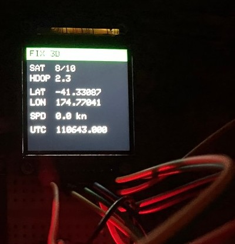
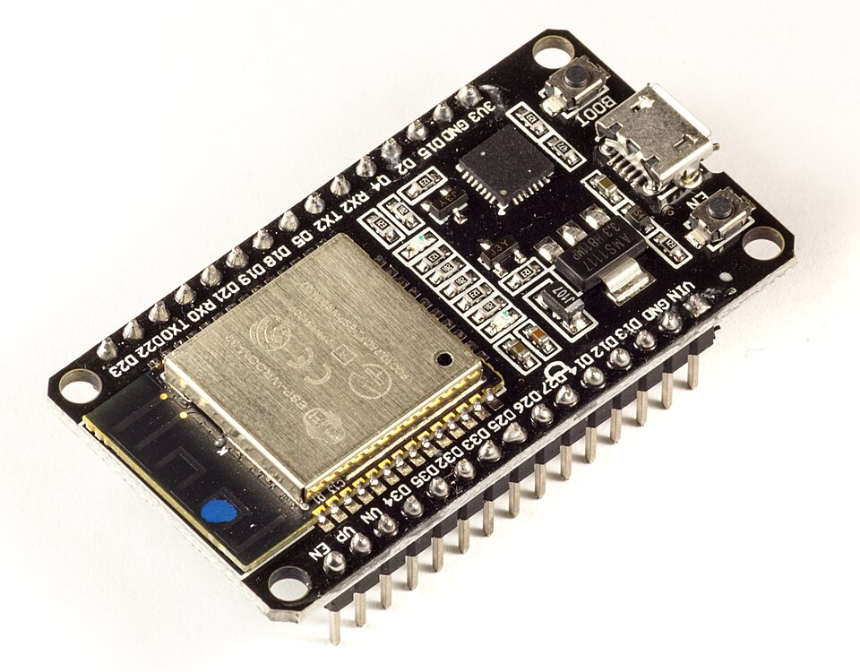
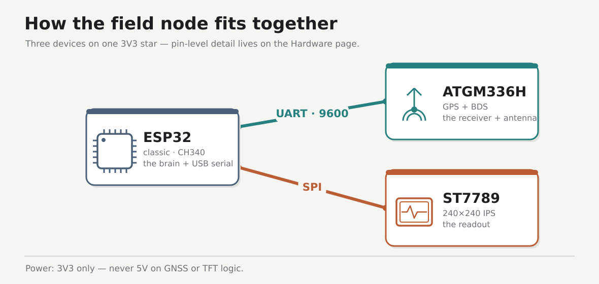

# ESP32 GNSS field

A portable GNSS field node you wire yourself — antenna to the sky, fix quality and position on a bright little TFT.

The finished node — a clear-sky 3D fix drives the panel green, sats and HDOP climbing, lat/lon locked in.

Classic ESP32 with a CH340 bridge — the brain of the field node.

## Story

This started as a parts pile: a classic ESP32 (CH340), an ATGM336H GPS+BDS module, and a 240×240 ST7789. The goal was never a survey rover or a cloud pipeline — just a **local field node** on Ubuntu you can follow phase by phase, until outdoors you get a **3D fix** and the panel goes **green**.

v1 bring-up runs through Phase 7. Each phase stays a frozen snapshot so you can replay the exact path; later extras (SoftAP, microSD log, PPS, NTRIP) land as new folders, never rewrites of old ones.

!!! note "A learning demo, not a survey instrument"
    This is a bench/field project to learn the receiver → quality → display pipeline. Consumer GNSS without corrections is **metre-class** at best — fine for learning, not for marking property lines.

The shape of it — ESP32 talks to the GNSS over UART and the TFT over SPI. Pin-level wiring is on the [Hardware](hardware.md) page.

## Start here

Runs on Ubuntu. Follow the phases in order, one checkpoint at a time.

| Doc | Role |
|-----|------|
| [Prerequisites](prerequisites.md) | Install the tools — assume nothing |
| [Hardware](hardware.md) | Parts, pin map, wiring |
| [Firmware](firmware.md) | Per-phase `firmware/<nn>-…/` folders |
| [Phase 0 → 7](phases/00-usb-erase.md) | The bring-up walkthrough, one checkpoint at a time |
| [Lab log](lab-log.md) | Bench scoreboard — wins and failures |
