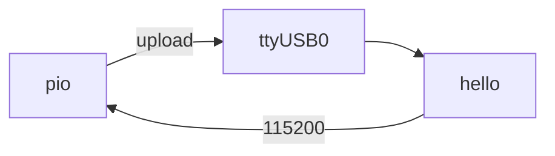

# Phase 1 — Hello flash

Build, flash, and read serial on the erased ESP32. No GNSS or TFT yet — just prove the tool chain.



## Firmware

**Changed — first app.** Standalone tree [`firmware/01-hello/`](../../firmware/01-hello/) — leave it alone later; new phases get new folders. Tracker: [Firmware](../firmware.md).

## Preconditions

- [Prerequisites](../prerequisites.md) done (`pio` on `PATH`)
- [Checkpoint 0](00-usb-erase.md) passed
- Board → `/dev/ttyUSB0`

---

## 1.1 See the serial device

If the host only shows root hubs, the cable or port is wrong (a charge-only cable bites here):

<div class="run" markdown>

```bash
lsusb
ls /dev/ttyUSB* /dev/ttyACM* 2>/dev/null
```

```text {.no-copy}
Bus 001 Device 001: ID 1d6b:0002 Linux Foundation 2.0 root hub
Bus 002 Device 001: ID 1d6b:0003 Linux Foundation 3.0 root hub
# no ttyUSB / ttyACM — swap to a data cable or the other USB port
```

</div>

When the CH340 enumerates:

<div class="run" markdown>

```bash
lsusb
ls -la /dev/ttyUSB* /dev/serial/by-id/
```

```text {.no-copy}
Bus 001 Device 014: ID 1a86:7523 QinHeng Electronics CH340 serial converter
crw-rw-rw- 1 root dialout … /dev/ttyUSB0
…/by-id/usb-1a86_USB_Serial-if00-port0 -> ../../ttyUSB0
```

</div>

That's CH340 → `/dev/ttyUSB0`. After an unplug/replug the number can move (`ttyUSB0` → `ttyUSB1`) — re-check `ls /dev/ttyUSB*` and use whatever shows.

---

## 1.2 Build

<div class="run" markdown>

```bash
cd firmware/01-hello
pio run -e esp32dev
```

```text {.no-copy}
Processing esp32dev (platform: espressif32; board: esp32dev; framework: arduino)
--------------------------------------------------------------------------------
Verbose mode can be enabled via `-v, --verbose` option
CONFIGURATION: https://docs.platformio.org/page/boards/espressif32/esp32dev.html
PLATFORM: Espressif 32 (55.3.39) > Espressif ESP32 Dev Module
HARDWARE: ESP32 240MHz, 320KB RAM, 4MB Flash
DEBUG: Current (cmsis-dap) External (cmsis-dap, esp-bridge, esp-prog, esp-prog-2, iot-bus-jtag, jlink, minimodule, olimex-arm-usb-ocd, olimex-arm-usb-ocd-h, olimex-arm-usb-tiny-h, olimex-jtag-tiny, tumpa)
PACKAGES: 
 - contrib-piohome @ 3.4.4 
 - framework-arduinoespressif32 @ 3.3.9 
 - framework-arduinoespressif32-libs @ 5.5.4+sha.735507283d 
 - tool-esptoolpy @ 5.3.0 
 - tool-xtensa-esp-elf-gdb @ 17.1.0+20260402 
 - toolchain-xtensa-esp-elf @ 14.2.0+20260121
LDF: Library Dependency Finder -> https://bit.ly/configure-pio-ldf
LDF Modes: Finder ~ chain, Compatibility ~ soft
Found 43 compatible libraries
Scanning dependencies...
Dependency Graph
|-- WiFi @ 3.3.9
Building in release mode
Retrieving maximum program size .pio/build/esp32dev/firmware.elf
Checking size .pio/build/esp32dev/firmware.elf
Advanced Memory Usage is available via "PlatformIO Home > Project Inspect"
RAM:   [=         ]  13.8% (used 45248 bytes from 327680 bytes)
Flash: [=======   ]  69.2% (used 906724 bytes from 1310720 bytes)
========================= [SUCCESS] Took 2.28 seconds =========================
```

</div>

---

## 1.3 Upload

<div class="run" markdown>

```bash
pio run -e esp32dev -t upload --upload-port /dev/ttyUSB0
```

```text {.no-copy}
Processing esp32dev (platform: espressif32; board: esp32dev; framework: arduino)
--------------------------------------------------------------------------------
Verbose mode can be enabled via `-v, --verbose` option
CONFIGURATION: https://docs.platformio.org/page/boards/espressif32/esp32dev.html
PLATFORM: Espressif 32 (55.3.39) > Espressif ESP32 Dev Module
HARDWARE: ESP32 240MHz, 320KB RAM, 4MB Flash
DEBUG: Current (cmsis-dap) External (cmsis-dap, esp-bridge, esp-prog, esp-prog-2, iot-bus-jtag, jlink, minimodule, olimex-arm-usb-ocd, olimex-arm-usb-ocd-h, olimex-arm-usb-tiny-h, olimex-jtag-tiny, tumpa)
PACKAGES: 
 - contrib-piohome @ 3.4.4 
 - framework-arduinoespressif32 @ 3.3.9 
 - framework-arduinoespressif32-libs @ 5.5.4+sha.735507283d 
 - tool-esptoolpy @ 5.3.0 
 - tool-xtensa-esp-elf-gdb @ 17.1.0+20260402 
 - toolchain-xtensa-esp-elf @ 14.2.0+20260121
LDF: Library Dependency Finder -> https://bit.ly/configure-pio-ldf
LDF Modes: Finder ~ chain, Compatibility ~ soft
Found 43 compatible libraries
Scanning dependencies...
Dependency Graph
|-- WiFi @ 3.3.9
Building in release mode
Retrieving maximum program size .pio/build/esp32dev/firmware.elf
Checking size .pio/build/esp32dev/firmware.elf
Advanced Memory Usage is available via "PlatformIO Home > Project Inspect"
RAM:   [=         ]  13.8% (used 45248 bytes from 327680 bytes)
Flash: [=======   ]  69.2% (used 906724 bytes from 1310720 bytes)
Configuring upload protocol...
AVAILABLE: cmsis-dap, esp-bridge, esp-prog, esp-prog-2, espota, esptool, iot-bus-jtag, jlink, minimodule, olimex-arm-usb-ocd, olimex-arm-usb-ocd-h, olimex-arm-usb-tiny-h, olimex-jtag-tiny, tumpa
CURRENT: upload_protocol = esptool
Looking for upload port...
Uploading .pio/build/esp32dev/firmware.bin
esptool v5.3.0
Serial port /dev/ttyUSB0:
Connecting....
Connected to ESP32 on /dev/ttyUSB0:
Chip type:          ESP32-D0WD-V3 (revision v3.1)
Features:           Wi-Fi, BT, Dual Core + LP Core, 240MHz, Vref calibration in eFuse, Coding Scheme None
Crystal frequency:  40MHz
MAC:                8c:94:df:6d:c9:5c

Uploading stub flasher...
Running stub flasher...
Stub flasher running.
Changing baud rate to 460800...
Changed.

Configuring flash size...
Auto-detected flash size: 4MB

Writing '/home/johna/workspace/jajera/esp32-gnss-field/firmware/01-hello/.pio/build/esp32dev/bootloader.bin' at 0x00001000...
SHA digest in image updated.
Flash will be erased from 0x00001000 to 0x00006fff...
Compressed 23552 bytes to 15127...

Writing at 0x00001000 [░░░░░░░░░░░░░░░░░░░░░░░░░░░░░░]   0.0% 0/15127 bytes... 

Writing at 0x00006c00 [██████████████████████████████] 100.0% 15127/15127 bytes... 
Wrote 23552 bytes (15127 compressed) at 0x00001000 in 0.6 seconds (324.8 kbit/s).
Verifying written data...
Hash of data verified.

Writing '/home/johna/workspace/jajera/esp32-gnss-field/firmware/01-hello/.pio/build/esp32dev/partitions.bin' at 0x00008000...
Flash will be erased from 0x00008000 to 0x00008fff...
Compressed 3072 bytes to 146...

Writing at 0x00008000 [░░░░░░░░░░░░░░░░░░░░░░░░░░░░░░]   0.0% 0/146 bytes... 

Writing at 0x00008c00 [██████████████████████████████] 100.0% 146/146 bytes... 
Wrote 3072 bytes (146 compressed) at 0x00008000 in 0.0 seconds (724.1 kbit/s).
Verifying written data...
Hash of data verified.

Writing '/home/johna/.platformio/packages/framework-arduinoespressif32/tools/partitions/boot_app0.bin' at 0x0000e000...
Flash will be erased from 0x0000e000 to 0x0000ffff...
Compressed 8192 bytes to 47...

Writing at 0x0000e000 [░░░░░░░░░░░░░░░░░░░░░░░░░░░░░░]   0.0% 0/47 bytes... 

Writing at 0x00010000 [██████████████████████████████] 100.0% 47/47 bytes... 
Wrote 8192 bytes (47 compressed) at 0x0000e000 in 0.1 seconds (872.2 kbit/s).
Verifying written data...
Hash of data verified.

Writing '.pio/build/esp32dev/firmware.bin' at 0x00010000...
Flash will be erased from 0x00010000 to 0x000edfff...
Compressed 907136 bytes to 578642...

Writing at 0x00010000 [░░░░░░░░░░░░░░░░░░░░░░░░░░░░░░]   0.0% 0/578642 bytes... 
...
Writing at 0x000ed780 [██████████████████████████████] 100.0% 578642/578642 bytes... 
Wrote 907136 bytes (578642 compressed) at 0x00010000 in 14.4 seconds (504.2 kbit/s).
Verifying written data...
Hash of data verified.

Hard resetting via RTS pin...
========================= [SUCCESS] Took 20.54 seconds =========================
```

</div>

Stuck on `Connecting…`? Hold **BOOT**, tap **EN**, release **BOOT**, retry.

---

## 1.4 Serial

<div class="run" markdown>

```bash
pio device monitor -b 115200 --port /dev/ttyUSB0
```

```text {.no-copy}
--- Terminal on /dev/ttyUSB0 | 115200 8-N-1
--- Available filters and text transformations: debug, default, direct, esp32_exception_decoder, hexlify, log2file, nocontrol, printable, send_on_enter, time
--- More details at https://bit.ly/pio-monitor-filters
--- Quit: Ctrl+C | Menu: Ctrl+T | Help: Ctrl+T followed by Ctrl+H
gnss-field hello — phase 1
MAC=8C:94:DF:6D:C9:5C
chip=ESP32 flash=4MB
gnss-field hello MAC=8C:94:DF:6D:C9:5C uptime_ms=674
gnss-field hello MAC=8C:94:DF:6D:C9:5C uptime_ms=1675
gnss-field hello MAC=8C:94:DF:6D:C9:5C uptime_ms=2675
gnss-field hello MAC=8C:94:DF:6D:C9:5C uptime_ms=3675
```

</div>

Tap **EN** if you opened the monitor after boot and missed the banner. MAC should match Phase 0. Quit with **Ctrl+C**.

---

## Checkpoint 1

- [x] Build succeeds
- [x] Upload verifies
- [x] Serial shows the hello line every ~1 s
- [x] Logged in [Lab log](../lab-log.md)

**Next:** [Phase 2 — Power the TFT](02-tft-power.md)
