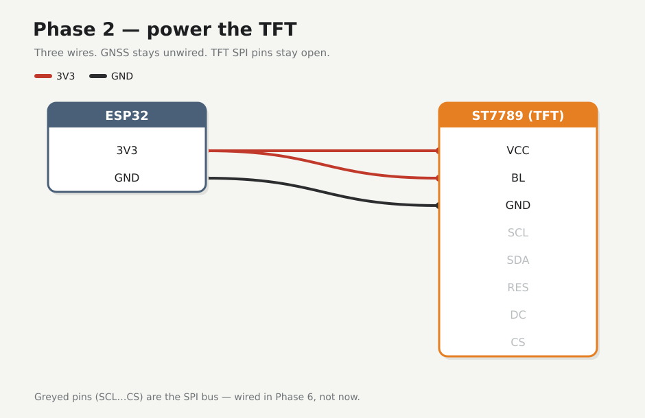

# Phase 2 — Power the TFT

Three wires to the display only. Backlight is the quick check. Leave the GNSS alone.

## Firmware

**Unchanged** — [`firmware/01-hello/`](../../firmware/01-hello/).

## Preconditions

Checkpoint 1 done. TFT 8-pin header on. Unplug USB while seating jumpers.

!!! warning
    Power the TFT from **3V3 only** — 5V on the logic can kill the module. After wiring, check for heat and ~3.3 V on VCC before trusting it.

---

## Wires



| From ESP32 | To |
|------------|-----|
| **3V3** | TFT **VCC**, TFT **BL** |
| **GND** | TFT **GND** |

Match **3V3** / **GND** by silk. Star on the breadboard rails ([how the board is tied](../hardware.md#breadboard-default-connectivity)). TFT SPI pins stay open.

---

## Check

Plug USB. Module cool. Meter ≈ 3.3 V on TFT VCC. Backlight on. After unplug/replug the port may move (`ttyUSB0` → `ttyUSB1`) — check with `ls /dev/ttyUSB*` first.

<div class="run" markdown>

```bash
pio device monitor -b 115200 --port /dev/ttyUSB0
```

```text {.no-copy}
gnss-field hello MAC=8C:94:DF:6D:C9:5C uptime_ms=5080613
```

</div>

## Checkpoint 2

- [x] Those three TFT wires only
- [x] ~3.3 V, backlight on, no heat
- [x] Hello still prints
- [x] [Lab log](../lab-log.md)

**Next:** [Phase 3 — GNSS power](03-gnss-power.md)
