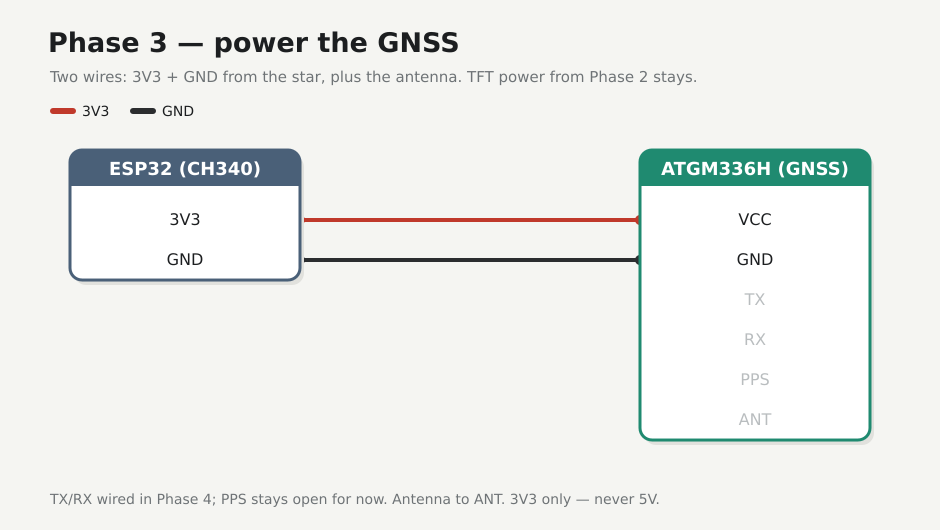

# Phase 3 — GNSS power

Two wires: GNSS supply from the 3V3 star, plus the antenna. No UART data yet — just prove the module lives without browning out the bus. TFT power from Phase 2 stays.

## Firmware

**Unchanged** — [`firmware/01-hello/`](../../firmware/01-hello/). Tracker: [Firmware](../firmware.md).

## Preconditions

[Checkpoint 2](02-tft-power.md) passed (TFT still powered). ATGM336H + antenna on the desk. Unplug USB while seating jumpers.

!!! warning
    Power the GNSS from **3V3 only** — 5V on the logic can kill the module. After wiring, check for heat and ~3.3 V on VCC before trusting it.

---

## Wires



| From star | To ATGM336H |
|-----------|-------------|
| **3V3** | **VCC** |
| **GND** | **GND** |

Tap the same breadboard 3V3/GND star as the TFT ([Hardware — Breadboard](../hardware.md#breadboard-default-connectivity)). Silk on many modules reads `VCC · GND · TX · RX · PPS` (order varies — trust the labels). Leave **TX RX PPS** open until Phase 4. Fit the antenna (U.FL pigtail / ceramic patch as supplied) before you expect any later fix.

---

## Check

Plug USB and check the port — it may have moved after the unplug:

<div class="run" markdown>

```bash
ls /dev/ttyUSB*
```

```text {.no-copy}
/dev/ttyUSB0
# or /dev/ttyUSB1 — use whichever ls shows
```

</div>

Then eyeball the power:

- Module cool — if warm or smelling, unplug and recheck polarity / 5V.
- Meter ≈ **3.3 V** on ATGM336H **VCC** to **GND** if you have one.
- TFT backlight still on.

Finally, confirm hello still ticks (bus not browned out):

<div class="run" markdown>

```bash
cd firmware/01-hello
pio device monitor -b 115200 --port /dev/ttyUSB0
```

```text {.no-copy}
--- Terminal on /dev/ttyUSB0 | 115200 8-N-1
--- Quit: Ctrl+C | Menu: Ctrl+T | Help: Ctrl+T followed by Ctrl+H
gnss-field hello MAC=8C:94:DF:6D:C9:5C uptime_ms=...
gnss-field hello MAC=8C:94:DF:6D:C9:5C uptime_ms=...
```

</div>

Some modules blink an LED after a while outdoors; indoors it may stay dark — OK for this phase. NMEA comes in Phase 4.

---

## Checkpoint 3

- [x] GNSS **VCC**/**GND** from the star only (`TX RX PPS` open)
- [x] Antenna attached
- [x] ~3.3 V, no heat; TFT backlight still on
- [x] Hello serial still alive
- [x] Logged in [Lab log](../lab-log.md)

**Next:** [Phase 4 — NMEA raw](04-nmea-raw.md)
