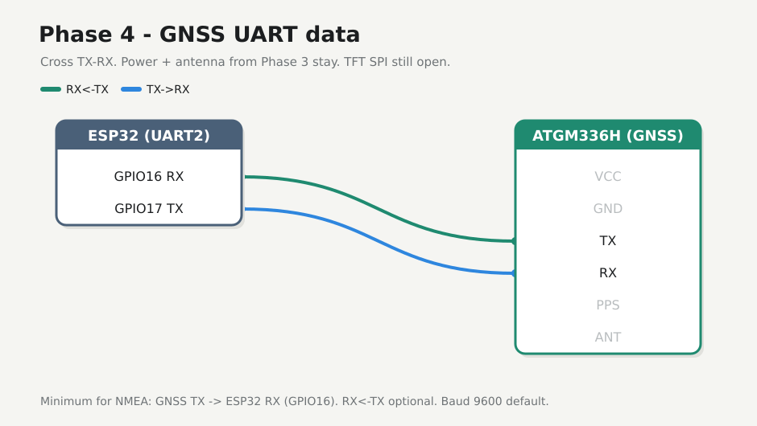

# Phase 4 — NMEA raw

Wire UART and mirror `$G…` / `$B…` lines to the USB serial monitor. No parsing yet. Power and antenna from Phase 3 stay on.

## Firmware

**Changed.** New folder [`firmware/04-nmea-raw/`](../../firmware/04-nmea-raw/). Do not edit `01-hello`. UART2 `RX=16` `TX=17` baud **9600**.

## Preconditions

- [Checkpoint 3](03-gnss-power.md) passed
- GNSS powered; antenna on
- Unplug USB while seating the data jumpers

---

## 4.1 Data wires



| ESP32 | ATGM336H |
|-------|---------|
| **GPIO16** (RX2) | **TX** |
| **GPIO17** (TX2) | **RX** (optional for now) |

**Cross TX↔RX** — module TX drives ESP RX. Shared GND already from the star. Leave PPS open. Do not wire TFT SPI yet.

---

## 4.2 Flash mirror

Stop any serial monitor on the port first. Check which `/dev/ttyUSB*` is up after replug.

<div class="run" markdown>

```bash
ls /dev/ttyUSB*
cd firmware/04-nmea-raw
pio run -e esp32dev -t upload --upload-port /dev/ttyUSB0
```

```text {.no-copy}
/dev/ttyUSB0
Processing esp32dev (platform: espressif32; board: esp32dev; framework: arduino)
--------------------------------------------------------------------------------
Verbose mode can be enabled via `-v, --verbose` option
CONFIGURATION: https://docs.platformio.org/page/boards/espressif32/esp32dev.html
PLATFORM: Espressif 32 (55.3.39) > Espressif ESP32 Dev Module
HARDWARE: ESP32 240MHz, 320KB RAM, 4MB Flash
DEBUG: Current (cmsis-dap) External (cmsis-dap, esp-bridge, esp-prog, esp-prog-2, iot-bus-jtag, jlink, minimodule, olimex-arm-usb-ocd, olimex-arm-usb-ocd-h, olimex-arm-usb-tiny-h, olimex-jtag-tiny, tumpa)
PACKAGES: 
 - contrib-piohome @ 3.4.4 
 - framework-arduinoespressif32 @ 3.3.9 
 - framework-arduinoespressif32-libs @ 5.5.4+sha.735507283d 
 - tool-esptoolpy @ 5.3.0 
 - tool-xtensa-esp-elf-gdb @ 17.1.0+20260402 
 - toolchain-xtensa-esp-elf @ 14.2.0+20260121
LDF: Library Dependency Finder -> https://bit.ly/configure-pio-ldf
LDF Modes: Finder ~ chain, Compatibility ~ soft
Found 43 compatible libraries
Scanning dependencies...
No dependencies
Building in release mode
Retrieving maximum program size .pio/build/esp32dev/firmware.elf
Checking size .pio/build/esp32dev/firmware.elf
Advanced Memory Usage is available via "PlatformIO Home > Project Inspect"
RAM:   [=         ]   6.8% (used 22148 bytes from 327680 bytes)
Flash: [==        ]  22.1% (used 289836 bytes from 1310720 bytes)
Configuring upload protocol...
AVAILABLE: cmsis-dap, esp-bridge, esp-prog, esp-prog-2, espota, esptool, iot-bus-jtag, jlink, minimodule, olimex-arm-usb-ocd, olimex-arm-usb-ocd-h, olimex-arm-usb-tiny-h, olimex-jtag-tiny, tumpa
CURRENT: upload_protocol = esptool
Looking for upload port...
Uploading .pio/build/esp32dev/firmware.bin
esptool v5.3.0
Serial port /dev/ttyUSB0:
Connecting......
Connected to ESP32 on /dev/ttyUSB0:
Chip type:          ESP32-D0WD-V3 (revision v3.1)
Features:           Wi-Fi, BT, Dual Core + LP Core, 240MHz, Vref calibration in eFuse, Coding Scheme None
Crystal frequency:  40MHz
MAC:                8c:94:df:6d:c9:5c

Uploading stub flasher...
Running stub flasher...
Stub flasher running.
Changing baud rate to 460800...
Changed.

Configuring flash size...
Auto-detected flash size: 4MB

Writing '/home/johna/workspace/jajera/esp32-gnss-field/firmware/04-nmea-raw/.pio/build/esp32dev/bootloader.bin' at 0x00001000...
SHA digest in image updated.
Flash will be erased from 0x00001000 to 0x00006fff...
Compressed 23552 bytes to 15127...

Writing at 0x00001000 [░░░░░░░░░░░░░░░░░░░░░░░░░░░░░░]   0.0% 0/15127 bytes... 

Writing at 0x00006c00 [██████████████████████████████] 100.0% 15127/15127 bytes... 
Wrote 23552 bytes (15127 compressed) at 0x00001000 in 0.8 seconds (248.5 kbit/s).
Verifying written data...
Hash of data verified.

Writing '/home/johna/workspace/jajera/esp32-gnss-field/firmware/04-nmea-raw/.pio/build/esp32dev/partitions.bin' at 0x00008000...
Flash will be erased from 0x00008000 to 0x00008fff...
Compressed 3072 bytes to 146...

Writing at 0x00008000 [░░░░░░░░░░░░░░░░░░░░░░░░░░░░░░]   0.0% 0/146 bytes... 

Writing at 0x00008c00 [██████████████████████████████] 100.0% 146/146 bytes... 
Wrote 3072 bytes (146 compressed) at 0x00008000 in 0.1 seconds (363.6 kbit/s).
Verifying written data...
Hash of data verified.

Writing '/home/johna/.platformio/packages/framework-arduinoespressif32/tools/partitions/boot_app0.bin' at 0x0000e000...
Flash will be erased from 0x0000e000 to 0x0000ffff...
Compressed 8192 bytes to 47...

Writing at 0x0000e000 [░░░░░░░░░░░░░░░░░░░░░░░░░░░░░░]   0.0% 0/47 bytes... 

Writing at 0x00010000 [██████████████████████████████] 100.0% 47/47 bytes... 
Wrote 8192 bytes (47 compressed) at 0x0000e000 in 0.1 seconds (446.9 kbit/s).
Verifying written data...
Hash of data verified.

Writing '.pio/build/esp32dev/firmware.bin' at 0x00010000...
Flash will be erased from 0x00010000 to 0x00056fff...
Compressed 290240 bytes to 158532...

Writing at 0x00010000 [░░░░░░░░░░░░░░░░░░░░░░░░░░░░░░]   0.0% 0/158532 bytes... 
...
Writing at 0x00056dc0 [██████████████████████████████] 100.0% 158532/158532 bytes... 
Wrote 290240 bytes (158532 compressed) at 0x00010000 in 4.2 seconds (552.8 kbit/s).
Verifying written data...
Hash of data verified.

Hard resetting via RTS pin...
========================= [SUCCESS] Took 9.64 seconds =========================
```

</div>

<div class="run" markdown>

```bash
pio device monitor -b 115200 --port /dev/ttyUSB0
```

```text {.no-copy}
--- Terminal on /dev/ttyUSB0 | 115200 8-N-1
--- Available filters and text transformations: debug, default, direct, esp32_exception_decoder, hexlify, log2file, nocontrol, printable, send_on_enter, time
--- More details at https://bit.ly/pio-monitor-filters
--- Quit: Ctrl+C | Menu: Ctrl+T | Help: Ctrl+T followed by Ctrl+H
gnss-field nmea-raw — phase 4
UART2 RX=16 TX=17 baud=9600
$GNGGA,,,,,,0,00,25.5,,,,,,*64
$GNGLL,,,,,,V,N*7A
$GNGSA,A,1,,,,,,,,,,,,,25.5,25.5,25.5,1*01
$GNGSA,A,1,,,,,,,,,,,,,25.5,25.5,25.5,4*04
$GPGSV,1,1,00,0*65
$BDGSV,1,1,00,0*74
$GNRMC,,V,,,,,,,,,,N,V*37
$GNVTG,,,,,,,,,N*2E
$GNZDA,,,,,,*56
$GPTXT,01,01,01,ANTENNA OK*35
$GNGGA,,,,,,0,00,25.5,,,,,,*64
$GNGLL,,,,,,V,N*7A
$GNGSA,A,1,,,,,,,,,,,,,25.5,25.5,25.5,1*01
$GNGSA,A,1,,,,,,,,,,,,,25.5,25.5,25.5,4*04
$GPGSV,1,1,00,0*65
$BDGSV,1,1,00,0*74
$GNRMC,,V,,,,,,,,,,N,V*37
$GNVTG,,,,,,,,,N*2E
$GNZDA,,,,,,*56
$GPTXT,01,01,01,ANTENNA OK*35
```

</div>

Indoors you may get empty fields / no fix (`V` / `0` sats) — still a Pass if sentences keep arriving. `$GPTXT,…ANTENNA OK` is a good health hint. Outdoor / clear sky is for a real fix later.

---

## 4.3 If no lines / garbage

- Confirm **TX→GPIO16** seated (the required wire)
- Recheck TX/RX not both on the same net
- Shared GND / 3V3 still good; module not burning hot
- Shorter jumpers
- Still garbage? Change `GNSS_BAUD` to **115200** in `main.cpp`, rebuild, reflash

---

## Checkpoint 4

- [x] Serial shows NMEA-looking lines
- [x] Stable across a reset
- [x] Logged in [Lab log](../lab-log.md)

**Next:** [Phase 5 — Fix parse](05-fix-parse.md)
