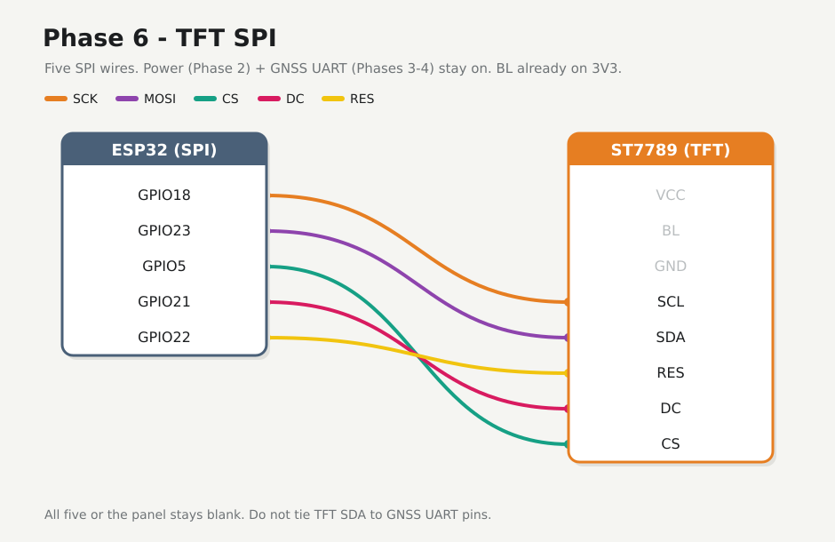

# Phase 6 — Wire TFT SPI + fill screen

Add five SPI wires and prove the panel draws. Power (Phase 2) and GNSS UART (Phases 3–4) stay on. **BL** is already on **3V3** — no new backlight wire.


## Firmware

**Changed.** New folder [`firmware/06-tft-fill/`](../../firmware/06-tft-fill/).

## Preconditions

- [Checkpoint 5](05-fix-parse.md) passed
- Unplug USB while seating SPI jumpers

---

## 6.1 SPI wires



| ESP32 | TFT |
|-------|-----|
| **GPIO18** | **SCL** (SCK) |
| **GPIO23** | **SDA** (MOSI) |
| **GPIO5** | **CS** |
| **GPIO21** | **DC** |
| **GPIO22** | **RES** |

Keep Phase 2 **VCC** / **GND** / **BL**. Do **not** tie TFT SDA to GNSS UART. All five SPI wires or the panel stays blank.

---

## 6.2 Flash

Stop any serial monitor on the port first. Check which `/dev/ttyUSB*` is up.

<div class="run" markdown>

```bash
ls /dev/ttyUSB*
cd firmware/06-tft-fill
pio run -e esp32dev -t upload --upload-port /dev/ttyUSB0
```

```text {.no-copy}
/dev/ttyUSB0
Processing esp32dev (platform: espressif32; board: esp32dev; framework: arduino)
--------------------------------------------------------------------------------
Verbose mode can be enabled via `-v, --verbose` option
CONFIGURATION: https://docs.platformio.org/page/boards/espressif32/esp32dev.html
PLATFORM: Espressif 32 (55.3.39) > Espressif ESP32 Dev Module
HARDWARE: ESP32 240MHz, 320KB RAM, 4MB Flash
DEBUG: Current (cmsis-dap) External (cmsis-dap, esp-bridge, esp-prog, esp-prog-2, iot-bus-jtag, jlink, minimodule, olimex-arm-usb-ocd, olimex-arm-usb-ocd-h, olimex-arm-usb-tiny-h, olimex-jtag-tiny, tumpa)
PACKAGES: 
 - contrib-piohome @ 3.4.4 
 - framework-arduinoespressif32 @ 3.3.9 
 - framework-arduinoespressif32-libs @ 5.5.4+sha.735507283d 
 - tool-esptoolpy @ 5.3.0 
 - tool-xtensa-esp-elf-gdb @ 17.1.0+20260402 
 - toolchain-xtensa-esp-elf @ 14.2.0+20260121
LDF: Library Dependency Finder -> https://bit.ly/configure-pio-ldf
LDF Modes: Finder ~ chain, Compatibility ~ soft
Found 48 compatible libraries
Scanning dependencies...
Dependency Graph
|-- Adafruit ST7735 and ST7789 Library @ 1.12.0
|-- Adafruit GFX Library @ 1.13.0
|-- Adafruit BusIO @ 1.17.4
|-- SPI @ 3.3.9
Building in release mode
esptool v5.3.0
Retrieving maximum program size .pio/build/esp32dev/firmware.elf
Checking size .pio/build/esp32dev/firmware.elf
Advanced Memory Usage is available via "PlatformIO Home > Project Inspect"
RAM:   [=         ]   7.2% (used 23708 bytes from 327680 bytes)
Flash: [===       ]  26.1% (used 342440 bytes from 1310720 bytes)
esptool v5.3.0
Configuring upload protocol...
AVAILABLE: cmsis-dap, esp-bridge, esp-prog, esp-prog-2, espota, esptool, iot-bus-jtag, jlink, minimodule, olimex-arm-usb-ocd, olimex-arm-usb-ocd-h, olimex-arm-usb-tiny-h, olimex-jtag-tiny, tumpa
CURRENT: upload_protocol = esptool
Looking for upload port...
Uploading .pio/build/esp32dev/firmware.bin
esptool v5.3.0
Serial port /dev/ttyUSB0:
Connecting....
Connected to ESP32 on /dev/ttyUSB0:
Chip type:          ESP32-D0WD-V3 (revision v3.1)
Features:           Wi-Fi, BT, Dual Core + LP Core, 240MHz, Vref calibration in eFuse, Coding Scheme None
Crystal frequency:  40MHz
MAC:                8c:94:df:6d:c9:5c

Uploading stub flasher...
Running stub flasher...
Stub flasher running.
Changing baud rate to 460800...
Changed.

Configuring flash size...
Auto-detected flash size: 4MB

Writing '/home/johna/workspace/jajera/esp32-gnss-field/firmware/06-tft-fill/.pio/build/esp32dev/bootloader.bin' at 0x00001000...
SHA digest in image updated.
Flash will be erased from 0x00001000 to 0x00006fff...
Compressed 23552 bytes to 15127...

Writing at 0x00001000 [░░░░░░░░░░░░░░░░░░░░░░░░░░░░░░]   0.0% 0/15127 bytes... 

Writing at 0x00006c00 [██████████████████████████████] 100.0% 15127/15127 bytes... 
Wrote 23552 bytes (15127 compressed) at 0x00001000 in 0.7 seconds (254.2 kbit/s).
Verifying written data...
Hash of data verified.

Writing '/home/johna/workspace/jajera/esp32-gnss-field/firmware/06-tft-fill/.pio/build/esp32dev/partitions.bin' at 0x00008000...
Flash will be erased from 0x00008000 to 0x00008fff...
Compressed 3072 bytes to 146...

Writing at 0x00008000 [░░░░░░░░░░░░░░░░░░░░░░░░░░░░░░]   0.0% 0/146 bytes... 

Writing at 0x00008c00 [██████████████████████████████] 100.0% 146/146 bytes... 
Wrote 3072 bytes (146 compressed) at 0x00008000 in 0.1 seconds (366.5 kbit/s).
Verifying written data...
Hash of data verified.

Writing '/home/johna/.platformio/packages/framework-arduinoespressif32/tools/partitions/boot_app0.bin' at 0x0000e000...
Flash will be erased from 0x0000e000 to 0x0000ffff...
Compressed 8192 bytes to 47...

Writing at 0x0000e000 [░░░░░░░░░░░░░░░░░░░░░░░░░░░░░░]   0.0% 0/47 bytes... 

Writing at 0x00010000 [██████████████████████████████] 100.0% 47/47 bytes... 
Wrote 8192 bytes (47 compressed) at 0x0000e000 in 0.1 seconds (473.1 kbit/s).
Verifying written data...
Hash of data verified.

Writing '.pio/build/esp32dev/firmware.bin' at 0x00010000...
Flash will be erased from 0x00010000 to 0x00063fff...
Compressed 342848 bytes to 187525...
Writing at 0x00010000 [░░░░░░░░░░░░░░░░░░░░░░░░░░░░░░]   0.0% 0/187525 bytes... 
...
Writing at 0x00063b40 [██████████████████████████████] 100.0% 187525/187525 bytes... 
Wrote 342848 bytes (187525 compressed) at 0x00010000 in 4.9 seconds (565.4 kbit/s).
Verifying written data...
Hash of data verified.

Hard resetting via RTS pin...
========================= [SUCCESS] Took 27.73 seconds =========================
```

</div>

<div class="run" markdown>

```bash
pio device monitor -b 115200 --port /dev/ttyUSB0
```

```text {.no-copy}
--- Terminal on /dev/ttyUSB0 | 115200 8-N-1
--- Available filters and text transformations: debug, default, direct, esp32_exception_decoder, hexlify, log2file, nocontrol, printable, send_on_enter, time
--- More details at https://bit.ly/pio-monitor-filters
--- Quit: Ctrl+C | Menu: Ctrl+T | Help: Ctrl+T followed by Ctrl+H
gnss-field tft-fill — phase 6
SPI SCK=18 MOSI=23 CS=5 DC=21 RST=22
cycling red → green → blue every 1 s
fill RED
fill GREEN
fill BLUE
fill RED
fill GREEN
fill BLUE
fill RED
```

</div>

Panel should cycle full-screen **red → green → blue** every 1 s. Serial `fill RED` / `GREEN` / `BLUE` tracks the same loop.

---

## 6.3 If blank

Firmware can print `fill RED` while the panel stays black — that means SPI is not reaching the glass.

- Backlight still on (Phase 2 **BL→3V3**)?
- All five SPI jumpers seated — silk **SCL SDA RES DC CS** (RES ≠ DevKit EN/RST)
- Cross-check: **GPIO18→SCL**, **GPIO23→SDA (MOSI)**, **GPIO5→CS**, **GPIO21→DC**, **GPIO22→RES**
- Do not swap **DC** and **RES**, or **SCL** and **SDA**
- Bench firmware uses `init(240, 240, SPI_MODE3)` @ 20 MHz; if still blank try `SPI_MODE2` in `main.cpp` and reflash
- DuPont / long jumpers: drop to `tft.setSPISpeed(10000000)`

---

## Checkpoint 6

- [x] Visible full-screen colour cycle on TFT
- [x] Serial shows `fill RED` / `GREEN` / `BLUE`
- [x] Logged in [Lab log](../lab-log.md)

**Next:** [Phase 7 — Field UI](07-field-ui.md)
