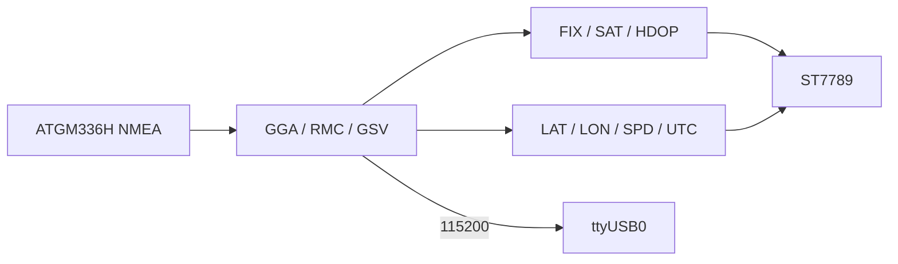

# Phase 7 — Field UI

Take the antenna outdoors: after a cold start, **FIX** climbs NONE → 3D, the status bar goes **green**, and lat/lon lock on the 240×240. No new wires.


As built — a clear-sky **3D** fix drives the panel green, sats and HDOP climbing, lat/lon locked. ST7789 on the breadboard; ESP32 + ATGM336H off-frame in the jumpers.

## Firmware

[`firmware/07-field-ui/`](../../firmware/07-field-ui/) · [`src/main.cpp`](../../firmware/07-field-ui/src/main.cpp)

Same UART2 `RX=16` `TX=17` @ **9600**, same TFT SPI + `init(240, 240, SPI_MODE3)`. Tracker: [Firmware](../firmware.md).

## Preconditions

- [Checkpoint 6](06-tft-fill.md) passed (panel draws)
- Antenna on; outdoor or clear sky for a real **3D** fix

---

## 7.1 Demo

1. Flash (see [7.2](#72-flash)). Screen shows **FIX NONE** (red bar) while the receiver acquires.
2. Indoors: `sats` may tick up slowly; **UTC** can update before lat/lon; zeros for position are normal.
3. Move outdoors — antenna flat to open sky, away from eaves.
4. Sats used climb → bar **yellow** (2D / poor HDOP) → **green** **FIX 3D**; LAT/LON fill; HDOP drops.
5. Walk ~20 m — position drifts; **SPD** ticks when moving.

Serial: `fix=… sats=…/… hdop=… lat=… lon=…` about once a second (mirrors the glass).



| On screen | From |
|-----------|------|
| Status bar colour | Fix + HDOP — red NONE · yellow 2D / HDOP&gt;2.5 · green 3D |
| **FIX** | GGA quality (0 → NONE; else treated as 3D here) |
| **SAT** | GGA sats used / GSV in view |
| **HDOP** | GGA HDOP |
| **LAT** / **LON** | GGA (or RMC when status `A`) |
| **SPD** | RMC speed (knots) |
| **UTC** | GGA / RMC time |

!!! note "A learning demo, not a survey instrument"
    Consumer GNSS without corrections is **metre-class** at best. The panel is a field readout of the NMEA pipeline — not a cadastral tool.

---

## 7.2 Flash

Stop any serial monitor on the port first. Check which `/dev/ttyUSB*` is up.

<div class="run" markdown>

```bash
ls /dev/ttyUSB*
cd firmware/07-field-ui
pio run -e esp32dev -t upload --upload-port /dev/ttyUSB0
```

```text {.no-copy}
/dev/ttyUSB0
Processing esp32dev (platform: espressif32; board: esp32dev; framework: arduino)
--------------------------------------------------------------------------------
Verbose mode can be enabled via `-v, --verbose` option
CONFIGURATION: https://docs.platformio.org/page/boards/espressif32/esp32dev.html
PLATFORM: Espressif 32 (55.3.39) > Espressif ESP32 Dev Module
HARDWARE: ESP32 240MHz, 320KB RAM, 4MB Flash
DEBUG: Current (cmsis-dap) External (cmsis-dap, esp-bridge, esp-prog, esp-prog-2, iot-bus-jtag, jlink, minimodule, olimex-arm-usb-ocd, olimex-arm-usb-ocd-h, olimex-arm-usb-tiny-h, olimex-jtag-tiny, tumpa)
PACKAGES: 
 - contrib-piohome @ 3.4.4 
 - framework-arduinoespressif32 @ 3.3.9 
 - framework-arduinoespressif32-libs @ 5.5.4+sha.735507283d 
 - tool-esptoolpy @ 5.3.0 
 - tool-xtensa-esp-elf-gdb @ 17.1.0+20260402 
 - toolchain-xtensa-esp-elf @ 14.2.0+20260121
LDF: Library Dependency Finder -> https://bit.ly/configure-pio-ldf
LDF Modes: Finder ~ chain, Compatibility ~ soft
Found 48 compatible libraries
Scanning dependencies...
Dependency Graph
|-- Adafruit ST7735 and ST7789 Library @ 1.12.0
|-- Adafruit GFX Library @ 1.13.0
|-- Adafruit BusIO @ 1.17.4
|-- SPI @ 3.3.9
Building in release mode
esptool v5.3.0
Retrieving maximum program size .pio/build/esp32dev/firmware.elf
Checking size .pio/build/esp32dev/firmware.elf
Advanced Memory Usage is available via "PlatformIO Home > Project Inspect"
RAM:   [=         ]   7.3% (used 23988 bytes from 327680 bytes)
Flash: [===       ]  26.8% (used 351016 bytes from 1310720 bytes)
esptool v5.3.0
Configuring upload protocol...
AVAILABLE: cmsis-dap, esp-bridge, esp-prog, esp-prog-2, espota, esptool, iot-bus-jtag, jlink, minimodule, olimex-arm-usb-ocd, olimex-arm-usb-ocd-h, olimex-arm-usb-tiny-h, olimex-jtag-tiny, tumpa
CURRENT: upload_protocol = esptool
Looking for upload port...
Uploading .pio/build/esp32dev/firmware.bin
esptool v5.3.0
Serial port /dev/ttyUSB0:
Connecting.....
Connected to ESP32 on /dev/ttyUSB0:
Chip type:          ESP32-D0WD-V3 (revision v3.1)
Features:           Wi-Fi, BT, Dual Core + LP Core, 240MHz, Vref calibration in eFuse, Coding Scheme None
Crystal frequency:  40MHz
MAC:                8c:94:df:6d:c9:5c

Uploading stub flasher...
Running stub flasher...
Stub flasher running.
Changing baud rate to 460800...
Changed.

Configuring flash size...
Auto-detected flash size: 4MB

Writing '/home/johna/workspace/jajera/esp32-gnss-field/firmware/07-field-ui/.pio/build/esp32dev/bootloader.bin' at 0x00001000...
SHA digest in image updated.
Flash will be erased from 0x00001000 to 0x00006fff...
Compressed 23552 bytes to 15127...

Writing at 0x00001000 [░░░░░░░░░░░░░░░░░░░░░░░░░░░░░░]   0.0% 0/15127 bytes... 

Writing at 0x00006c00 [██████████████████████████████] 100.0% 15127/15127 bytes... 
Wrote 23552 bytes (15127 compressed) at 0x00001000 in 0.8 seconds (245.5 kbit/s).
Verifying written data...
Hash of data verified.

Writing '/home/johna/workspace/jajera/esp32-gnss-field/firmware/07-field-ui/.pio/build/esp32dev/partitions.bin' at 0x00008000...
Flash will be erased from 0x00008000 to 0x00008fff...
Compressed 3072 bytes to 146...

Writing at 0x00008000 [░░░░░░░░░░░░░░░░░░░░░░░░░░░░░░]   0.0% 0/146 bytes... 

Writing at 0x00008c00 [██████████████████████████████] 100.0% 146/146 bytes... 
Wrote 3072 bytes (146 compressed) at 0x00008000 in 0.1 seconds (371.1 kbit/s).
Verifying written data...
Hash of data verified.

Writing '/home/johna/.platformio/packages/framework-arduinoespressif32/tools/partitions/boot_app0.bin' at 0x0000e000...
Flash will be erased from 0x0000e000 to 0x0000ffff...
Compressed 8192 bytes to 47...

Writing at 0x0000e000 [░░░░░░░░░░░░░░░░░░░░░░░░░░░░░░]   0.0% 0/47 bytes... 

Writing at 0x00010000 [██████████████████████████████] 100.0% 47/47 bytes... 
Wrote 8192 bytes (47 compressed) at 0x0000e000 in 0.1 seconds (461.3 kbit/s).
Verifying written data...
Hash of data verified.

Writing '.pio/build/esp32dev/firmware.bin' at 0x00010000...
Flash will be erased from 0x00010000 to 0x00065fff...
Compressed 351424 bytes to 193724...
Writing at 0x00010000 [░░░░░░░░░░░░░░░░░░░░░░░░░░░░░░]   0.0% 0/193724 bytes... 
...
Writing at 0x00065cc0 [██████████████████████████████] 100.0% 193724/193724 bytes... 
Wrote 351424 bytes (193724 compressed) at 0x00010000 in 5.1 seconds (555.9 kbit/s).
Verifying written data...
Hash of data verified.

Hard resetting via RTS pin...
========================= [SUCCESS] Took 19.31 seconds =========================
```

</div>

<div class="run" markdown>

```bash
pio device monitor -b 115200 --port /dev/ttyUSB0
```

```text {.no-copy}
--- Terminal on /dev/ttyUSB0 | 115200 8-N-1
--- Available filters and text transformations: debug, default, direct, esp32_exception_decoder, hexlify, log2file, nocontrol, printable, send_on_enter, time
--- More details at https://bit.ly/pio-monitor-filters
--- Quit: Ctrl+C | Menu: Ctrl+T | Help: Ctrl+T followed by Ctrl+H
gnss-field field-ui — phase 7
fix=NONE sats=0/0 hdop=99.9 lat=0.000000 lon=0.000000
fix=NONE sats=0/0 hdop=25.5 lat=0.000000 lon=0.000000
fix=NONE sats=0/1 hdop=25.5 lat=0.000000 lon=0.000000
fix=NONE sats=0/1 hdop=25.5 lat=0.000000 lon=0.000000
```

</div>

Indoors cold start looks like that — `NONE`, lat/lon zero, HDOP stuck high. Outdoors the same lines climb to `fix=3D` with real coordinates (glass capture above).

---

## 7.3 Customize

Edit constants in `main.cpp`, rebuild/flash.

| Want… | Change |
|-------|--------|
| Blank / flaky panel | Keep `SPI_MODE3`; try `tft.setSPISpeed(10000000)` |
| Yellow bar sooner / later | `hdop > 2.5f` in `statusColor()` |
| Faster / slower UI refresh | `1000` ms gate in `loop()` |
| Different UART baud | `GNSS_BAUD` (try **115200** if NMEA is garbage) |

---

## Checkpoint 7

- [x] Indoors: serial `fix=` lines ~1 Hz; TFT shows FIX / SAT / HDOP / LAT / LON
- [x] Outdoors: **FIX 3D**, green bar, sats in use, lat/lon locked
- [x] Knobs documented

**v1 bring-up complete.** Later phases (SoftAP, SD, PPS, NTRIP) get new folders — don’t rewrite `07-field-ui`.
